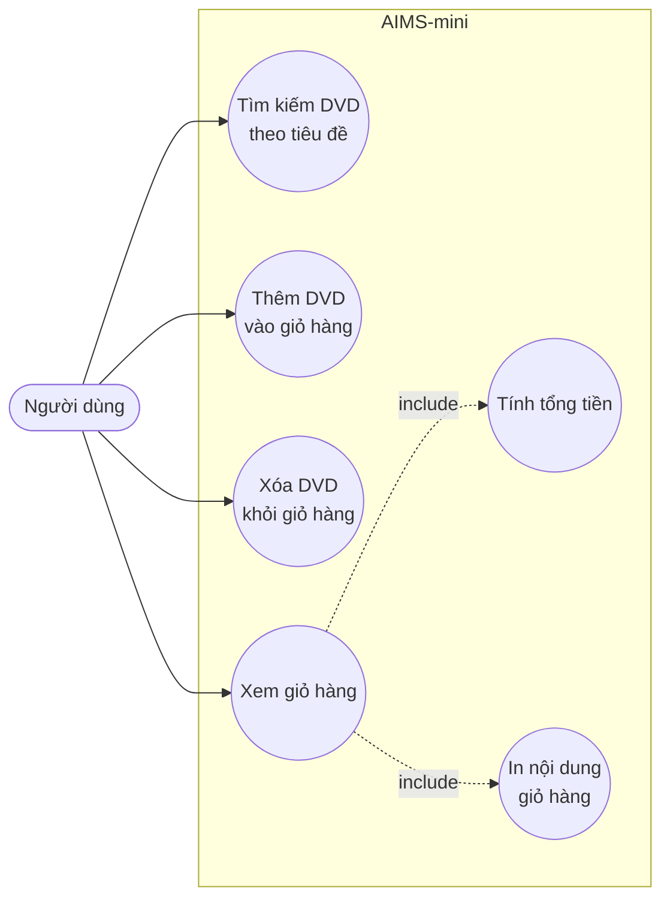

# Biểu đồ Use Case của AIMS-mini

Biểu đồ dưới đây mô tả các chức năng hiện có của ứng dụng: tìm kiếm DVD
theo tiêu đề và quản lý các DVD trong giỏ hàng.

## Mô tả các use case

| Use case | Mô tả |
| --- | --- |
| Tìm kiếm DVD theo tiêu đề | Tìm các DVD có tiêu đề chứa từ khóa, không phân biệt hoa thường. |
| Thêm DVD vào giỏ hàng | Thêm một DVD vào giỏ nếu giỏ chưa đạt giới hạn. |
| Xóa DVD khỏi giỏ hàng | Xóa DVD đang có trong giỏ hàng. |
| Xem giỏ hàng | Hiển thị các DVD hiện có trong giỏ. Use case này bao gồm tính tổng tiền và in nội dung giỏ hàng. |
| Tính tổng tiền | Cộng giá của tất cả DVD trong giỏ hàng. |
| In nội dung giỏ hàng | In danh sách DVD và tổng tiền ra màn hình. |